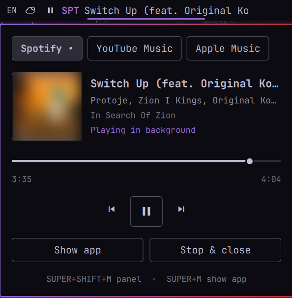

# Music for Omarchy: Spotify, YouTube Music and Apple Music from the bar

An Omarchy bar widget and panel for the three big music services. Each runs as its
official web app, parked out of sight on a hidden overlay; you search and browse in
the app, and play, pause, skip and seek from the bar.

By [iceteps](https://github.com/iceteps). MIT licensed.



- **One widget, three services.** Tabs switch between Spotify, YouTube Music and
  Apple Music; a `•` marks the ones running.
- **Official web apps only.** No API keys, no developer accounts, no unofficial
  libraries, no background service. You sign in once per service, in its own app.
- **Knows which service is playing.** Each service runs in its own Chromium profile,
  so each has its own media player and the bar can tell them apart and control each.
- **Only the playing service stays alive.** Music starting on one service closes the
  others, and a service that is not playing closes a minute after it is out of sight
  (hidden and not open in the panel). Logins stay; Start reopens one in seconds.
  So a paused service you walk away from closes too; resume it with Start.
  A service on screen or open in the panel is never closed: you are using it.
- **Out of the way.** Each app lives on its own hidden overlay (`special:music-<id>`) and keeps
  playing there. Show one to search, hide it again; the others stay hidden.

## Requirements

- Omarchy 4 with the Quickshell shell (omarchy-shell) and Hyprland's Lua config
  (the helper uses `hyprctl eval`).
- `chromium` (Omarchy's default browser), `jq` and `file` (all on a stock Omarchy).
- Recommended: a Chromium that has played protected content once (Widevine). The
  helper copies that module into each new profile so Spotify and Apple Music play on
  the first start; without it, the first start fetches it and the second one plays.

## Install

```
omarchy plugin add https://github.com/iceteps/omarchy-music --enable
```

It lands in the bar centre by default; to place it yourself:
`omarchy bar move iceteps.music --section center` (or `left`, `right`).

Optional, the command line helper on your PATH:

```
ln -s ~/.config/omarchy/plugins/iceteps.music/bin/iceteps-music ~/.local/bin/
```

Optional keys, in `~/.config/hypr/bindings.lua` (the second needs the PATH link):

```lua
hl.unbind("SUPER + SHIFT + M")
o.bind("SUPER + SHIFT + M", "Music panel", "omarchy-shell shell toggle iceteps.music")
o.bind("SUPER + M", "Show or hide music apps", "iceteps-music toggle")
```

`SUPER+SHIFT+M` is Omarchy's "Music" key, which starts the native Spotify client;
the `unbind` line hands it to this panel. Pick other keys if you use that client.

## Use

| Where | What |
|---|---|
| Bar | A note while nothing plays. Playing: the service tag (SPT, YTM, APL) and the track, scrolling when long. |
| Bar, click | On the play/pause icon: play/pause. Anywhere else: the panel, or, while an app is shown, hide it. Middle-click: play/pause. |
| Bar, hover | The cover, title and artist. |
| Panel, tabs | Pick the service. Left/Right arrows switch too. |
| Panel, not running | Where you left off: the last track, its cover, the time you stopped at and when. **Open** (or **Start** the first time) opens the app on the overlay, shown; press play there. |
| Panel, running | Cover, track, seek bar, previous / play-pause / next, **Show app** / **Hide app**, **Stop & close**. Showing an app closes the panel. Enter: play/pause. Esc: close. |
| Back from an app | `Esc`, click the widget, `SUPER+M`, or switch workspace. |
| Media keys | Unchanged: Omarchy's media keys drive whichever player is active. |

`Esc` is bound to hide only while a music app is on screen, and released the moment
it is hidden (however that happens), so Esc everywhere else is untouched. The cost:
while an app is shown, Esc does not reach it (to clear its search box, select the text).
The plugin binds and releases plain `Esc` only; any `Esc` binding of your own without
modifiers is released too.

The wheel does nothing on the widget on purpose: a touchpad sends scroll events when a
finger merely rests on it, and skipping tracks on those changed songs on hover.

### Command line

```
iceteps-music status              # JSON: which services run, their PIDs, which is shown
iceteps-music launch spotify      # start hidden (no-op if running)
iceteps-music launch apple --show # start and show the overlay
iceteps-music stop youtube        # close the app and its browser process
iceteps-music log                 # the last starts and stops, and why
iceteps-music show [id] | hide | toggle [id]
```

Services: `spotify`, `youtube`, `apple`. Check what the widget sees with
`omarchy-shell iceteps.music.debug dump`.

## How it works

```
iceteps-music launch <id>
  hyprctl eval  hl.exec_cmd("chromium --app=<url> --user-data-dir=<profile>",
                            { workspace = "special:music-<id> silent" })
     own browser process -> own MPRIS player  org.mpris.MediaPlayer2.chromium.instance<PID>
     window placed on the hidden overlay as it opens (no window rule, no config edit)

Panel.qml
  players        <- Quickshell MPRIS
  which service  <- PID in the player's D-Bus name == PID from `iceteps-music status`
```

Chromium publishes ONE media player per browser process, carrying no URL or site
name. In your everyday browser all three services would share it, so nothing could
tell which one plays. A profile per service gives each its own process and player.
`status` only counts a window whose browser was started with that service's profile,
so a Spotify tab in your everyday browser is never reported or closed by the plugin.

When a track changes, Chromium briefly reports the player as stopped, with no title
and its own logo as the artwork. The widget holds the last track through that gap and
shows a new cover only once it settles, so skipping does not flash.

Profiles live in `~/.local/share/iceteps-music/<id>/` (logins are kept there).
`~/.local/state/iceteps-music/` holds the last service started (`last`), each
service's last track and a copy of its cover (`last-<id>.json`, `cover-<id>-*`, saved
on a track change, when the panel opens and before a service closes), and the
start/stop log (`log`, last 200 lines). Nothing else is written.

After editing `Panel.qml`, run `omarchy-restart-shell`: a plugin hot reload keeps the
old code running.

## Remove

```
omarchy plugin remove iceteps.music
rm -r ~/.local/share/iceteps-music ~/.local/state/iceteps-music
rm -f ~/.local/bin/iceteps-music
```

Then delete the Music key lines from `bindings.lua` if you added them.

## Tests

```
node tests/model.test.mjs
```

Covers the player-to-service mapping, status parsing and time formatting.

## Credits

Made by [iceteps](https://github.com/iceteps). Issues and ideas:
[github.com/iceteps/omarchy-music](https://github.com/iceteps/omarchy-music).
